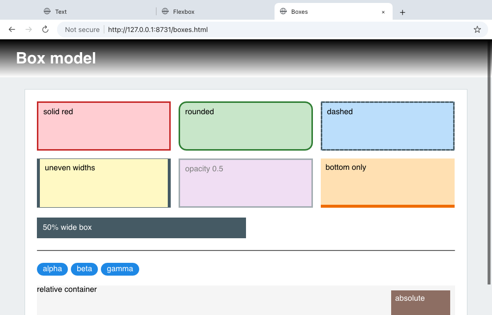
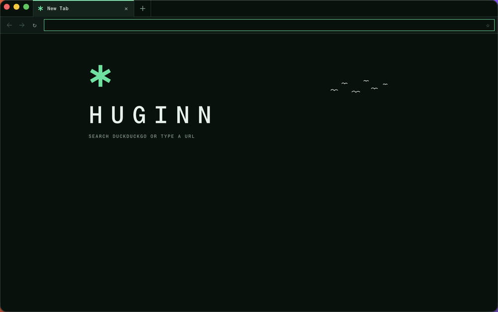
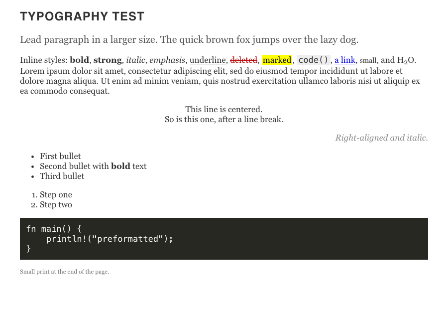

# Huginn

Huginn is a small web browser written in Rust. It is not a fork of Chromium,
WebKit, Gecko or Servo. It is one process, it draws on the CPU, and it runs on
macOS on Apple silicon and on Linux (x86-64, X11 and Wayland).



It is an experiment. It loads and renders many real pages well, but it is far
from a complete browser. See [Status and limitations](#status-and-limitations)
before you use it.

## What is ours and what we use

Huginn puts existing Rust libraries together with its own engine code.

| part | ours | library |
|---|---|---|
| HTML parsing | the DOM (an arena of nodes) and the tree builder glue | [html5ever](https://github.com/servo/html5ever) |
| CSS | the Stylo integration, presentational hints, the UA style sheet | [Stylo](https://github.com/servo/stylo), Servo's CSS engine |
| Layout | box tree, inline layout, tables, positioning | [Taffy](https://github.com/DioxusLabs/taffy) for block, flex and grid (vendored with small fixes), [Parley](https://github.com/linebender/parley) for text shaping and line breaks |
| Paint | display list, paint order, stacking contexts, clips | [vello_cpu](https://github.com/linebender/vello) rasterizes |
| JavaScript | the DOM bindings, the event loop, timers, forms | [V8](https://v8.dev) through [rusty_v8](https://github.com/denoland/rusty_v8) |
| Network and images | fetching, caching, which resources a page needs | ureq and rustls for HTTP, image, resvg and wuff for decoding |
| Window | tabs, toolbar, address bar, internal pages, selection, find, print to PDF | winit and softbuffer |

V8 is Chrome's JavaScript engine, and Stylo is the CSS engine of Servo and
Firefox. Huginn uses both as libraries. The rest of the engine is its own code
or the libraries above.

[ARCHITECTURE.md](ARCHITECTURE.md) explains the design. [CONTRACTS.md](CONTRACTS.md)
lists the interfaces between the crates. [THIRD-PARTY.md](THIRD-PARTY.md) lists
every dependency and its license.

## Benchmark

The benchmark in [`bench/`](bench/) loads 14 real pages from local snapshots
in Huginn, Ladybird and Chrome. Each browser starts cold, loads the page and
saves a 1280x800 screenshot, 5 times per page. Results from 2026-11-12, one
MacBook (Apple silicon), Huginn at commit 92cc567
([full table](bench/results/2026-11-12-huginn-92cc567.md)):

| | Huginn | Ladybird | Chrome |
|---|---|---|---|
| wall time, geometric mean | 71 ms | 530 ms | 264 ms |
| peak memory (RSS of all processes), geometric mean | 55 MB | 481 MB | 427 MB |
| SSIM against Chrome's screenshot, mean | 0.944 | 0.902 | 1.000 (reference) |

Huginn used less memory and less time than Ladybird on all 14 pages. Its
screenshot was within 0.02 SSIM of Ladybird's, or closer to Chrome, on all 14.

Read these numbers with care:

- **14 pages are a small sample.** They are mostly static documents, docs and
  landing pages. Heavy web apps are not in it.
- **Wall time includes process start and exit.** Huginn is one small process.
  Chrome and Ladybird start several.
- **Summed RSS favors one process.** It counts shared memory once per process.
  The full table also has the footprint, which does not.
- **SSIM is lenient.** A page can score 0.9 and still look clearly wrong to a
  person. Huginn's wikipedia screenshot scores 0.74.
- **This is not a JavaScript benchmark.** Huginn runs V8 without its JIT
  (`--lite-mode`). It would lose on Speedometer.
- **Huginn does much less than Ladybird.** It has no developer tools, no
  extensions, no sandbox, no GPU rendering, and it runs only on macOS.
- **Ladybird ran with a small local patch** that takes the screenshot at the
  load event (see `bench/README.md`). Chrome is `chrome-headless-shell` 157.

The page snapshots are not in this repository, because they are copies of
other people's sites. `bench/README.md` explains how to capture your own and
run the benchmark.

## Build

You need macOS on Apple silicon or Linux on x86-64, Rust 1.94 or newer, and
`python3` on your `PATH` (Stylo generates code at build time). The first build
downloads a prebuilt V8 library (about 40 MB).

On Linux the build needs a C toolchain but no development packages:
fontconfig, X11, Wayland and xkbcommon are loaded at run time. The Linux port
is newer than the macOS one: it uses the system's fontconfig fonts (with
Liberation fonts standing in for Arial, Times New Roman and Courier New), the
window has the normal title bar, and the shortcuts are Chrome's Linux ones
(Ctrl where macOS has Cmd). The benchmark numbers above are from macOS only.

```sh
cargo build --release -p huginn-shell
```

The binary is `target/release/huginn`. `--profile bench-release` gives the
fastest binary (fat LTO); use it for benchmark numbers.

## Use

Open a window:

```sh
huginn open https://example.com/
```

Render a page to a PNG without a window. It prints one JSON line with the time
of each phase:

```sh
huginn render https://example.com/ --out page.png --width 1280 --height 800
```

Other options: `--full-page`, `--no-js`. Keyboard shortcuts follow Chrome on
macOS; the list is in [ARCHITECTURE.md](ARCHITECTURE.md#shortcuts-and-gestures-chrome-on-macos).

| new tab | render without a window |
|---|---|
|  |  |

Environment variables: `HUGINN_PROFILE_DIR` (where bookmarks are saved; the
default is `~/Library/Application Support/Huginn`, on Linux `~/.config/huginn`),
`HUGINN_NO_JS=1`, `HUGINN_NET_LOOPBACK_ONLY=1` (no network except 127.0.0.1),
`HUGINN_LIVE_TABS` and `HUGINN_MEMORY_BUDGET_MB` (tab discarding).

## Status and limitations

Works: HTML parsing, most of modern CSS (through Stylo), block, flex, grid,
float and table layout, web fonts, SVG images, JavaScript with a DOM, forms,
tabs and windows, history, bookmarks, zoom, find in page, view source, save,
and print to PDF.

Missing or incomplete:

- **No sandbox and no site isolation.** Pages run in the same process as the
  browser. Do not use Huginn where security matters.
- macOS on Apple silicon and Linux on x86-64 only. On Linux, font discovery
  is not lazy yet (each start loads fontconfig's font list, about 13 ms).
- No developer tools, extensions, settings page or bookmarks bar.
- No CSS animations or transitions, no `@container`, no `@media print`.
- Style and layout run in full after each change, not incrementally.
- JavaScript: no iframes, no IME, no `contenteditable`. `fetch` and XHR
  after load block the tab.
- No disk cache. History lasts for one session.

ARCHITECTURE.md has a task list per crate.

## Contributing

See [CONTRIBUTING.md](CONTRIBUTING.md). The main rule: fix the browser, not the
page. No code may check for a specific site.

## How it was built

Esben Kran built Huginn with a team of AI coding agents in about one day
(12 November 2026). The agents wrote almost all of the code, and each crate had
an owner; CONTRACTS.md is how they agreed on the interfaces. The code has tests,
but it has not had the careful human review that a project of this size usually
gets.

## License

Licensed under either of [Apache License, Version 2.0](LICENSE-APACHE) or
[MIT license](LICENSE-MIT), at your option. Third-party code keeps its own
license; see [THIRD-PARTY.md](THIRD-PARTY.md).

Unless you state otherwise, any contribution you submit for inclusion in Huginn,
as defined in the Apache-2.0 license, is dual licensed as above, without any
additional terms or conditions.
